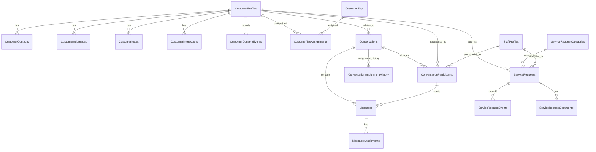

# Library ERP — CRM Database Design

**Document version:** 0.1 — review draft  
**Prepared for:** Library ERP team lead  
**Database platform:** Microsoft SQL Server  
**Service:** Customer Relationship Management (CRM)

---

## 1. Purpose

This document proposes the initial relational database design for the CRM microservice of a multi-tenant Library ERP platform. It is intended for architecture review and team agreement before production implementation.

The CRM service is responsible for customer relationships and CRM-owned communication workflows. It must be independently deployable and must not directly read or write another microservice's database.

This is a **proposal**, not an assertion that all business requirements or service boundaries have already been approved. The accompanying SQL file is an initial DDL draft and must be reviewed and tested before use.

## 2. CRM data ownership

### CRM owns

- Library-specific customer profiles and customer numbers.
- Customer contact methods and addresses.
- CRM customer tags, internal notes and recorded interactions.
- CRM-side communication consent history.
- CRM staff-directory profiles (business profile only).
- Conversations, participants, messages, attachment metadata and assignment history.
- Customer service requests, request comments and request event history.
- CRM audit entries.

### Other services own

| Data | Owning service | CRM stores |
|---|---|---|
| Login credentials, password hashes, authentication sessions | Identity & Access | External `IdentityUserId` only |
| Roles, permissions, role membership and authorization policies | Identity & Access | No authoritative permission tables |
| Library organizations/tenants and branch master records | Platform / Library Registry (to be agreed) | `TenantId` and `BranchId` references |
| Membership plans, subscription lifecycle and entitlements | Membership | Optional read-only summary or external IDs in a future projection |
| Invoices, payment transactions, card/payment-provider data | Accounting | No card data; optional payment summary from API/event |
| Books, editions, copies and catalog availability | Catalog / Circulation | No authoritative catalog tables |
| AC/camera/device commands and device state | Device Manager | Request context only; Device Manager executes commands |
| Coffee shop orders, items, prices and fulfillment | Ordering / Operations | Conversation or order-status reference only |
| Cross-library public discovery index | Discovery / Search | No global discovery index in CRM |

**Boundary rule:** CRM does not use cross-database foreign keys or direct SQL access to another service. Integration is through versioned APIs and, when adopted, published events.

## 3. Multi-tenancy and branch model

The product is intended to support multiple independent library organizations, each potentially operating multiple branches.

- `TenantId` identifies the library organization/tenant.
- `BranchId` identifies a branch within the tenant.
- Both are `uniqueidentifier` values issued/owned by the agreed platform or Library Registry service.
- CRM stores these IDs on relevant records but does not own the tenant or branch master data in this design.
- Tenant-owned CRM records include `TenantId`.
- Child relationships use composite foreign keys containing `TenantId`, preventing a child row from referencing a parent in another tenant.
- CRM must validate that any supplied `BranchId` belongs to the same `TenantId` through the agreed Registry/platform contract; a database column alone cannot prove this.
- Branch access is enforced by the application authorization layer; a `BranchId` column alone does not enforce permissions.
- Every request must obtain the allowed tenant/branch context from validated authentication and authorization. A client-supplied `TenantId` is not proof of access.

### Customer identity across libraries

A person may be a customer of more than one library. CRM therefore stores a separate `CustomerProfiles` row per tenant. A profile may optionally link to a global login account through `IdentityUserId`. Customer notes, conversations, requests and other private relationship data remain tenant-specific.

## 4. Proposed entity relationship overview

`TenantId`, `BranchId`, and `IdentityUserId` are external identifiers, not CRM-owned parent entities. Audit entries use a generic entity reference and therefore intentionally do not have a foreign key to every possible CRM table.

## 5. Table catalogue

| Table | Purpose | Important ownership/notes |
|---|---|---|
| `CustomerProfiles` | Main library-specific customer profile | CRM-owned; one profile per customer relationship/tenant |
| `CustomerContacts` | Multiple phone numbers and email addresses | Normalized values; no global uniqueness assumption |
| `CustomerAddresses` | Customer addresses | Country code and optional coordinates |
| `CustomerTags` | Tenant-specific tag definitions | Unique normalized tag name per tenant |
| `CustomerTagAssignments` | Many-to-many customer/tag relation | Composite primary key |
| `CustomerNotes` | Internal employee notes | Visibility level; not customer chat messages |
| `CustomerInteractions` | Recorded visits, calls, meetings and other interactions | CRM interaction timeline entries |
| `CustomerConsentEvents` | Append-only communication consent changes | Records grant/withdraw events; legal rules need jurisdiction review |
| `StaffProfiles` | CRM staff directory and business profile | Identity credentials/roles are not stored here |
| `Conversations` | Conversation-level metadata | Customer support, employee direct or group conversation |
| `ConversationParticipants` | Users participating in a conversation | Links CRM customer/staff profile to Identity account |
| `Messages` | Persisted message content and sender | SQL Server is source of truth; SignalR is delivery mechanism |
| `MessageAttachments` | Attachment metadata/storage pointer | Actual file bytes are stored outside SQL Server |
| `ConversationAssignmentHistory` | Conversation assignment history | Records who assigned a conversation and to whom |
| `ServiceRequestCategories` | Configurable request categories | Examples: facility, general assistance, complaint |
| `ServiceRequests` | Structured customer service tasks | Separate from chat conversations and coffee shop orders |
| `ServiceRequestEvents` | Status and assignment transition history | Append-only application behavior recommended |
| `ServiceRequestComments` | Public or internal request comments | Internal comments must not be shown to customers |
| `CrmAuditEntries` | CRM action and selected access audit trail | Append-only; avoid sensitive payloads |

## 6. Important fields and rules

### CustomerProfiles

- `CustomerId`: globally unique technical ID (`uniqueidentifier`).
- `TenantId`: owning library organization.
- `CustomerNumber`: human-readable customer number, unique within a tenant.
- `IdentityUserId`: nullable link to Identity; a walk-in customer can initially exist without a login account. The filtered unique index permits one customer profile per Identity account within a tenant.
- `HomeBranchId` and `RegisteredAtBranchId`: external branch identifiers.
- Names are required; birth date and other sensitive personal fields are optional.
- National ID is deliberately excluded from v0.1. Add it only if a real legal/business need is confirmed, with encryption, restricted access and retention rules.
- `RowVersion` supports optimistic concurrency.

### CustomerContacts

- Supports multiple contact methods per customer.
- `ContactType` is currently `Phone` or `Email`.
- `NormalizedValue` is produced by application logic (for example, normalized international phone format and normalized email representation).
- A customer may share a phone number with another customer; do not impose tenant-wide phone uniqueness without a confirmed rule.
- A filtered unique index allows one active primary contact per contact type for a customer.

### StaffProfiles

- Contains the employee's CRM-facing business profile.
- `IdentityUserId` is a reference to Identity; no password, token, role or permission columns are stored.
- Job title and department are descriptive profile data, not authorization rules.

### Conversations and messages

- A conversation is a communication thread; a service request is a task with a lifecycle. They are separate entities.
- SignalR pushes updates to connected clients. Messages are persisted before being announced.
- Reconnecting clients retrieve messages from the last known cursor; do not rely on SignalR delivery as permanent storage.
- `ClientMessageId` supports idempotent message submission/retry.
- A participant must be authorized to read/send within the conversation.
- The application must verify that participant `IdentityUserId` matches the associated CustomerProfile/StaffProfile identity link. This cross-row rule cannot be fully expressed by the current CHECK constraint. The application must also ensure a conversation customer is represented by the correct customer participant.
- `LastReadAtUtc` is a simple conversation read cursor for v0.1. Per-message delivery/read receipts can be added if the product requires them.

### Service requests

Proposed status codes:

| Value | Status |
|---:|---|
| 1 | New |
| 2 | Accepted |
| 3 | InProgress |
| 4 | WaitingForCustomer |
| 5 | WaitingForExternalService |
| 6 | Resolved |
| 7 | Closed |

Priority codes:

| Value | Priority |
|---:|---|
| 1 | Low |
| 2 | Normal |
| 3 | High |
| 4 | Urgent |

The application/domain layer must validate allowed status transitions; a CHECK constraint only validates the permitted values, not the transition sequence. Add a Cancelled state after the team agrees on the lifecycle.

### Customer and employee status codes

`CustomerProfiles.Status`:

| Value | Status |
|---:|---|
| 1 | Active |
| 2 | Inactive |
| 3 | Blocked |
| 4 | Archived |

`StaffProfiles.EmploymentStatus`:

| Value | Status |
|---:|---|
| 1 | Active |
| 2 | Suspended |
| 3 | Left |

Conversation status:

| Value | Status |
|---:|---|
| 1 | Open |
| 2 | Pending |
| 3 | Resolved |
| 4 | Closed |

## 7. Referential integrity and deletion policy

- CRM-owned parent/child relationships use foreign keys that include `TenantId`.
- No foreign keys point into Identity, Library Registry, Accounting, Membership or other service databases.
- No cascade delete is configured for customer-related history. Use archive/retention workflows rather than cascading deletion.
- A data-erasure workflow, if required by applicable law, must be designed with Accounting's statutory retention requirements and the relevant jurisdiction's privacy law.
- Generic audit records intentionally use `EntityType` and `EntityId` rather than a polymorphic foreign key.

## 8. Indexing and query considerations

The initial script includes indexes for:

- Customer search by tenant/name and tenant/status.
- Customer lookup by normalized contact value.
- One primary phone/email per customer and contact type.
- Customer interaction and note timelines.
- Conversation lists and message history.
- Message idempotency by client-generated ID.
- Assigned service requests, request status and customer request history.
- Audit history by entity and actor.

These indexes are a starting point. Capture actual query patterns and examine SQL Server execution plans before adding more indexes. Additional indexes increase write and storage costs.

## 9. Security, privacy and data handling

1. Enforce tenant isolation in every application query and write path.
2. Enforce branch scope through authorization policies and resource checks.
3. Do not trust tenant IDs or user IDs supplied by clients as authorization evidence.
4. Keep credentials, access tokens, payment-card data and device secrets out of CRM.
5. Do not store actual message attachment bytes in ordinary SQL columns; store them in controlled file/object storage and retain metadata/reference in SQL.
6. Scan uploaded attachments for malware before making them available to other users.
7. Restrict internal notes and internal service-request comments by permission.
8. Log important customer profile modifications, status changes, access denials and sensitive access events according to an agreed audit policy.
9. Avoid placing full PII or message bodies in audit metadata and application logs.
10. Define retention, export, correction and erasure procedures before production, with Iran-specific and other target-market legal review.

## 10. Deliberately excluded from CRM database v0.1

- Tenant and branch master records (owned by platform/Library Registry, pending agreement).
- User credentials, authentication sessions, roles and permissions (Identity & Access).
- Subscription plans, activation and membership entitlement records (Membership).
- Invoices, payment transaction details and payment card information (Accounting).
- Books, editions, copies, loans and reservations (Catalog/Circulation).
- AC/camera/device inventory, credentials, telemetry and commands (Device Manager).
- Coffee shop order, item, price, stock and fulfillment records (Ordering).
- Global library search index and geospatial ranking (Discovery).
- Full offline synchronization/outbox infrastructure (future design).
- Central multi-channel notification delivery (future Notification service). CRM can publish events or call the notification component once that contract is agreed.

## 11. Open decisions requiring team-lead approval

| # | Decision | Proposed default |
|---:|---|---|
| 1 | What service issues `TenantId` and `BranchId`? | Platform/Library Registry; standardize UUIDs |
| 2 | Does CRM store a separate customer profile per tenant? | Yes |
| 3 | Can a customer profile exist without an Identity account? | Yes, to support walk-in/reception registration |
| 4 | Which service owns employee login and permissions? | Identity & Access |
| 5 | Does CRM own staff business profiles? | Yes, but not credentials or permissions |
| 6 | Are customer support conversations always linked to a customer? | Yes for `CustomerSupport`; employee conversations are separate |
| 7 | Is a service request always associated with a customer? | Yes for this CRM MVP |
| 8 | Who owns in-app notifications? | To be agreed; avoid creating a competing notification database prematurely |
| 9 | What is the final request status lifecycle? | Proposed values in this document; validate with library staff |
| 10 | What is the attachment storage provider and retention policy? | Separate controlled storage; select before enabling uploads |
| 11 | Are national ID and date of birth genuinely required? | Not mandatory in v0.1 |
| 12 | Which data-retention/privacy rules apply in Iran and future markets? | Legal/business review required before production |
| 13 | Which SQL Server edition/version and collation will all developers use? | Team standardization required |
| 14 | Who owns database migration review and integration sign-off? | Team lead / designated database reviewer |

## 12. Implementation order

Do not create every table and feature in one large implementation step. A recommended order is:

1. Database/schema foundation and `CustomerProfiles`.
2. `CustomerContacts` and `CustomerAddresses`.
3. Customer search, status lifecycle and optimistic concurrency.
4. Tags, notes and interactions.
5. Staff profile link to Identity.
6. Conversations and participants.
7. Messages and attachment metadata.
8. Service request categories, requests and request history.
9. Consent and audit enhancements.
10. Cross-service read projections and integration events after contracts are agreed.

For each stage: write/approve a migration, test it on a clean database, add automated tests, update the ERD/documentation, and demonstrate it on Thursday.

## 13. Definition of done for this design hand-in

- [ ] CRM ownership boundaries reviewed by team lead.
- [ ] Tenant and branch ID ownership agreed.
- [ ] Identity integration boundary agreed.
- [ ] Table list and entity relationships reviewed.
- [ ] Status and request lifecycle values approved.
- [ ] SQL DDL reviewed and executed on a disposable development database.
- [ ] Constraints and tenant-isolation tests added before implementing API features.
- [ ] Initial migrations committed with a Pull Request.

---

**Companion file:** `CRM_Initial_Schema_v0.1.sql` contains the corresponding initial SQL Server DDL.
